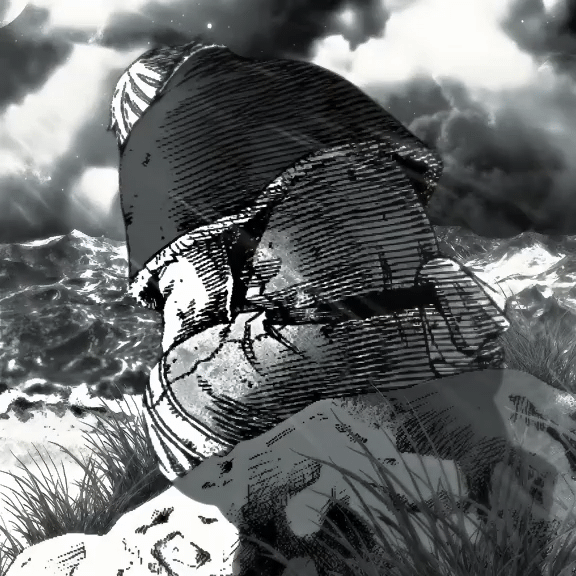

<h1 align="center">
  
</h1>

Hi! I'm João 👋 
-> 17 years old | System Developer | Brazil

I am a systems developer with a passion for technology. I'm currently delving into web development to become a Full-Stack developer.

### Contact me

<table>
  <tr>
    <td valign="top">

### Languages |

</td>
    <td valign="top" align="right" rowspan="2">
      
    </td>
  </tr>
  <tr>
    <td valign="top">

### Tools |

### Learning |

</td>
  </tr>
</table>
    
<!-- pacman -->
<picture data-importer="pacman">
  <source media="(prefers-color-scheme: dark)" srcset="https://raw.githubusercontent.com/zxmoura/zxmoura/pacman-output/pacman-contribution-graph-dark.svg?game=pacman">
  <source media="(prefers-color-scheme: dark)" srcset="https://raw.githubusercontent.com/zxmoura/zxmoura/pacman-output/pacman-contribution-graph.svg?game=pacman">
  
</picture>

### 
          
