Hi 👋! My name is João, and I'm studying programming at E.E. Dr. Jorge Coury.

###

  
  

###

  
  
  
  
  
  
  

###

  
  
  

###

<picture data-importer="pacman">
  <source media="(prefers-color-scheme: dark)" srcset="https://raw.githubusercontent.com/zxmoura/zxmoura/pacman-output/pacman-contribution-graph-dark.svg?game=pacman">
  <source media="(prefers-color-scheme: light)" srcset="https://raw.githubusercontent.com/zxmoura/zxmoura/pacman-output/pacman-contribution-graph.svg?game=pacman">
  
</picture>

###
